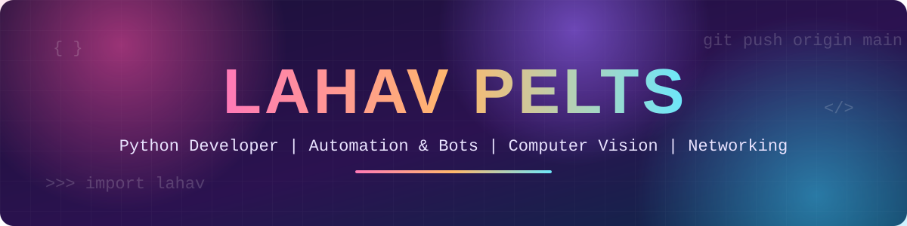

## 🎯 About Me

<table>
<tr>
<td width="60%" valign="top">

```python
class Lahav:
    name     = "Lahav Pelts"
    role     = "Developer & tinkerer"

    building = [
        "Face tracking with computer vision",
        "PacketChess - chess over the network",
        "Game automation bots",
    ]

    learning = ["Cyber security", "Networking", "System design"]

    tech = {
        "languages": ["Python", "C++", "JavaScript"],
        "tools":     ["Git", "Linux", "VS Code"],
    }
```

</td>
<td width="40%" align="center" valign="middle">


> *"First, solve the problem. Then, write the code."*
> — John Johnson

</td>
</tr>
</table>

## 📫 Connect With Me

<p align="center">
<a href="https://github.com/LahavPelts"></a>
<!-- Add your links: replace the # with your URL -->
<a href="#"></a>
<a href="#"></a>
<a href="#"></a>
<a href="#"></a>
</p>

## 🛠️ Tech Stack

<p align="center">
<br>

</p>

<p align="center">


</p>

## 🚀 Featured Projects

<p align="center">
<a href="https://github.com/LahavPelts/facetraking"></a>
<a href="https://github.com/LahavPelts/PacketChess"></a>
<a href="https://github.com/LahavPelts/hayday-farm-bot"></a>
</p>

## 📊 GitHub Analytics

<p align="center">

</p>
<p align="center">


</p>
<p align="center">


</p>

## 🏆 GitHub Trophies

<p align="center">

</p>
